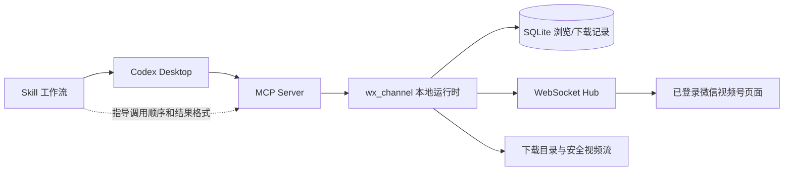

# wx_channel 视频号数据 MCP 与 Skill 需求（草案）

状态：待评审

日期：2026-11-06

本文只定义通过 Codex 查看 wx_channel 视频号数据的产品目标、技术原理、边界和实施难度，不包含本轮代码实现。

## 产品归属

本功能是 `wx_channel` 的增强能力，代码、MCP Server、Skill、配置和测试均归属于 `wx_channel` 项目。`wx_channel_insight` 与本需求无关，不作为数据源、业务依赖、部署目标或后续验收项目。

## 1. 目标与范围

目标是在 Codex 桌面端中直接查询 wx_channel 已保存的数据，并在微信桌面端页面可用时查询实时视频号数据。用户可以用自然语言完成以下操作：

- 查看最近浏览或下载的视频；
- 按标题、作者、视频号账号、日期和状态筛选；
- 查看单条视频的标题、作者、封面、分辨率、时长、文件大小、下载状态和互动数据；
- 查询视频号搜索结果或指定账号的视频列表；
- 查看指定视频的详情和评论；
- 判断数据来源、采集时间和是否需要打开微信页面刷新；
- 对已有本地视频返回可供后续视频分析使用的安全文件信息。

第一版聚焦“视频业务数据”和“本地媒体索引”。视频画面理解、OCR、转写、热点识别、自动剪辑和发布属于后续能力，不在第一版验收范围内。

## 2. 当前项目基础与事实

当前项目已经具备以下能力：

1. `browse_history` 和 `download_records` 保存浏览记录、下载记录、作者、标题、封面、时长、分辨率、文件路径和下载状态。
2. 浏览记录和下载记录已经保存点赞、评论、收藏、转发字段，但当前模型没有统一的播放量字段。播放量不可从缺失字段推断为 0。
3. `internal/api/search.go` 已提供视频搜索、账号视频列表、视频详情、评论列表和评论导出接口，兼容路由包括：
   - `/api/channels/feed/search`
   - `/api/channels/contact/feed/list`
   - `/api/channels/feed/profile`
   - `/api/channels/feed/comment/list`
4. 这些实时接口通过 WebSocket Hub 调用微信页面上下文。微信页面没有打开、注入脚本没有就绪或页面上下文不匹配时，接口会返回无可用客户端、超时或上下文不匹配错误。
5. `/api/browse`、`/api/downloads` 和 `/api/video/stream` 已经可以提供本地历史和下载文件访问；视频流会限制在配置的下载目录内，并支持 Range 请求。
6. 当前 Windows 应用的微信页面注入和生命周期管理是实时数据的主要来源。macOS/Linux 可以读取本地记录，但不能据此承诺实时微信数据能力。

因此，MCP 不应重新实现微信协议，也不应绕过登录、验证码、签名、加密或页面授权。它应作为 Codex 的受控访问层，复用 wx_channel 已有服务和 API。

## 3. 核心原理

推荐的数据链路如下：



MCP 和 Skill 的责任必须分开：

- MCP Server 提供实时数据、身份/权限检查、分页、错误状态和受控动作；
- Skill 提供什么时候调用哪个工具、如何组合结果、如何处理数据不完整以及最终如何回答；
- wx_channel 继续作为微信页面连接、数据解析、数据库和本地视频文件的事实来源。

Codex 支持连接外部 MCP Server；本地桌面端、CLI 和 IDE 扩展可以共享 MCP 配置。对于本项目，优先使用本机 STDIO 或仅绑定回环地址的 Streamable HTTP，不把微信数据接口暴露到局域网。官方文档说明了 STDIO、Streamable HTTP、Bearer/OAuth、server instructions、工具审批和项目级配置范围：[Model Context Protocol](https://learn.chatgpt.com/docs/extend/mcp)。

Skill 使用 `SKILL.md` 描述可触发的用户目标、调用顺序和输出格式。官方定义中，MCP 负责实时信息和受控动作，Skill 负责围绕这些工具的可复用工作流：[Skills](https://developers.openai.com/plugins/concepts/skills)。

不要实现“Codex 作为 MCP Server”的旧方案。官方已移除 `codex mcp-server`，当前方案是让 Codex 连接外部 MCP Server：[Codex MCP server removal](https://learn.chatgpt.com/docs/mcp-server)。

## 4. 推荐实现方案

### 4.1 第一阶段：内置只读 MCP 端点

推荐把 MCP 能力集成到 wx_channel 运行时中，由应用复用现有 `SearchService`、数据库服务、WebSocket Hub 和路径安全逻辑。传输层优先选择仅绑定 `127.0.0.1` 的 Streamable HTTP；如果 Go MCP SDK 接入成本过高，再退回一个独立 STDIO sidecar，通过本地受保护 API 访问 wx_channel。

选择内置端点的原因：

- 实时查询可以直接使用当前应用中的 WebSocket Hub 和就绪客户端选择器；
- 不需要第二个进程重新发现数据库路径、端口和微信页面状态；
- 可以复用现有的 `no_ready_client`、超时、页面上下文错误和分页语义；
- 未来加入下载或评论导出时，可以集中执行权限和审批控制。

当前 WebSocket/API 服务使用 `:端口` 监听，MCP 接入前必须确认并收紧为回环地址或增加独立认证，不能仅因为 MCP 客户端运行在本机就假定接口安全。

### 4.2 MCP 只读工具

第一版建议提供以下工具。名称是需求级接口名，实现时可以根据所选 Go MCP SDK 的命名规则调整。

| 工具 | 用途 | 数据来源 | 是否需要微信页面 |
| --- | --- | --- | --- |
| `get_runtime_status` | 返回应用、微信进程、注入、页面客户端和能力状态 | 运行时诊断 | 否 |
| `list_local_videos` | 分页查看浏览记录、下载记录或合并视图 | SQLite/现有 HTTP API | 否 |
| `get_local_video` | 查看单条视频和本地文件状态 | SQLite/下载目录 | 否 |
| `search_channel_videos` | 按关键词查询视频号内容 | 微信页面 API | 是 |
| `list_channel_videos` | 查询指定账号的视频列表 | 微信页面 API | 是 |
| `get_channel_video_profile` | 查询视频详情和互动数据 | 微信页面 API或分享页 | 通常是 |
| `list_channel_comments` | 分页查看评论 | 微信页面 API | 是 |
| `resolve_channel_share_link` | 解析受支持的视频号分享链接的元数据 | 微信页面 API | 是 |
| `get_local_media_metadata` | 返回本地文件的相对路径、大小、时长、分辨率和 MIME 类型 | 下载目录 | 否 |

工具返回必须带有以下公共字段：

```json
{
  "source": "local_database | live_wechat_page | shared_page | local_file",
  "observed_at": "2026-11-05T00:00:00Z",
  "freshness": "live | stored | stale | unknown",
  "partial": false,
  "warnings": []
}
```

具体要求：

- 列表工具必须分页，并返回 `next_cursor` 或明确的 `has_more`；禁止一次把全部历史、评论或原始响应塞入上下文。
- 互动数据使用可空字段。缺失、未返回、未授权和确实为 0 必须能区分，尤其是播放量。
- 实时查询必须报告是否有 ready client、当前页面能力和失败原因。
- 本地媒体只返回下载目录内的相对路径或受控媒体引用，不返回解密密钥、Cookie、Referer、完整签名 URL 或任意文件路径。
- 原始微信响应只允许进入受限调试日志，不作为 MCP 默认返回值。
- MCP 工具默认只读；任何下载、删除、导出、打开页面或发布动作都必须单独设计审批策略。

### 4.3 Skill 工作流

建议新增仓库级 Skill：

```text
.agents/skills/wechat-channel-insight/SKILL.md
```

Skill 的触发目标包括“查看视频号数据”“分析最近下载”“查某个账号视频”“查看视频互动数据”“为什么数据为空”等。工作流如下：

1. 调用 `get_runtime_status`，先判断只读本地数据还是查询实时数据。
2. 用户要求“最近下载/浏览/历史”时调用 `list_local_videos`。
3. 用户要求“最新/搜索/账号主页”时检查微信页面是否 ready；不可用时先说明需要打开或刷新支持的微信视频号页面。
4. 调用对应列表工具，再按用户条件调用详情工具，避免对每条记录无条件请求详情。
5. 只有用户要求评论时才调用评论工具；评论较多时使用分页并显示已读取数量。
6. 输出每个字段的来源和时间；缺失字段显示“未返回”，不补成 0。
7. 如果用户要求视频内容分析，先检查 `get_local_media_metadata` 是否有本地文件，再交给独立的视频理解能力；不能把元数据查询结果冒充画面分析结果。

Skill 的回答模板应包含：查询条件、数据来源、时间、结果、缺失字段、下一步操作。Skill 不负责绕过 MCP 权限，也不直接拼接微信内部 API 请求。

## 5. 权限、安全与隐私要求

这是本方案的硬约束：

1. MCP Server 默认只监听 `127.0.0.1`，或使用 STDIO；禁止默认监听 `0.0.0.0`。
2. Streamable HTTP 使用独立的本地 bearer token 或等效认证，不能复用会话 Cookie、微信密钥或下载解密密钥。
3. 工具分为 `read`、`export`、`download`、`delete`、`publish` 五类。第一版只启用 `read`。
4. 下载目录路径必须通过现有安全路径校验；MCP 只能访问配置下载目录内的文件。
5. 所有列表和评论查询都要限制页大小、最大返回字节数、并发数和超时；实时微信页面 API 要复用现有状态机，不能无限并发。
6. 日志中不得写入 Cookie、Authorization、解密 key、完整签名视频 URL 或用户隐私内容。
7. 如果未来支持远程 MCP 或插件分发，必须另做 OAuth、租户隔离、审计和数据留存设计。项目本地 MCP 不等于可以安全部署成公网服务。

## 6. 非目标

第一版不包含：

- 自动登录微信、绕过验证码或获取未授权账号数据；
- 直接调用未公开的公网视频号接口；
- 自动抓取任意网页或批量绕过分享链接限制；
- 返回原始 Cookie、解密 key、Referer 或完整签名下载 URL；
- 通过 MCP 自动下载、删除、发布或修改内容；
- OCR、ASR、画面理解、热点判断、脚本生成和视频克隆；
- 在 macOS/Linux 上承诺实时微信页面数据；
- 把“没有返回播放量”解释为“播放量为 0”。

## 7. 验收标准

### 本地数据

- Codex 能通过 MCP 查询最近浏览和下载视频，支持分页、关键词、作者和日期筛选。
- 单条记录能显示标题、作者、时长、分辨率、互动字段、下载状态和相对文件路径。
- 查询不存在的记录、数据库为空、文件已删除时，返回可解释的空结果或错误，不崩溃。
- 结果明确标注 `stored` 和 `observed_at`，不会把历史数据宣称为实时数据。

### 实时数据

- 微信页面 ready 时，Codex 能搜索视频、列出账号视频并查看详情。
- 微信页面未打开、注入未完成、上下文不匹配、接口超时和接口返回空数据时，返回稳定错误码和下一步操作。
- 分页游标能被 Skill 继续使用；不会把第一页误当成完整列表。
- 返回数据保留字段缺失状态和来源，不泄漏敏感请求信息。

### Skill

- 用户说“查看最新视频号数据”时，Skill 会先检查运行时状态，再选择实时或本地数据路径。
- 用户说“查看历史下载”时，不强制依赖微信页面。
- 用户要求视频内容分析时，Skill 能明确区分“元数据已获得”和“视频内容尚未分析”。
- 工具失败时，回答包含错误原因、数据范围和可执行的恢复动作。

## 8. 实施难度评估

按一名熟悉 Go、MCP 和 Windows 调试的开发者估算，以下估算包含接口、测试和文档，不包含后续插件上架审核时间：

| 范围 | 难度 | 估算 | 主要风险 |
| --- | --- | --- | --- |
| 只读本地历史 MCP | 低到中 | 2–4 人日 | API 认证、路径和分页一致性 |
| 实时搜索/账号列表/详情 | 中到高 | 3–6 人日 | 微信页面状态、内部响应变化、游标和上下文匹配 |
| 评论分页与导出只读查询 | 中 | 2–4 人日 | 页面 API 有状态、响应量和隐私数据 |
| Codex Skill 工作流 | 低 | 1–2 人日 | 触发描述、错误分支和字段来源表达 |
| 本地插件/打包安装 | 中 | 2–5 人日 | MCP 配置、版本兼容、权限与分发 |
| 视频画面/OCR/转写分析 | 高 | 5–10+ 人日 | 本地媒体传递、模型、资源消耗和结果可验证性 |

推荐的 Windows-first MVP 总量约为 8–14 人日。若只做本地数据库查询，可以压缩到 3–5 人日；如果一开始同时做实时微信、远程 MCP、视频内容理解和自动下载，复杂度会明显上升，且难以区分是数据获取问题还是模型分析问题。

## 9. 分阶段交付

### P0：接口和安全基线

- 确定 MCP 传输方式和工具命名；
- 为 MCP 增加本地认证、loopback 监听和统一错误结构；
- 为字段建立来源、时间、缺失和敏感级别标记；
- 用固定 JSON fixture 覆盖空数据、分页、ready client 不可用和字段缺失。

### P1：本地只读查询

- 实现 `get_runtime_status`、`list_local_videos`、`get_local_video`、`get_local_media_metadata`；
- 新增 Skill 并在 Codex 本地配置中验证；
- 完成数据库为空、文件不存在、路径越界和分页测试。

### P2：实时视频号数据

- 实现搜索、账号视频列表、视频详情和评论分页工具；
- 复用现有 WebSocket Hub 和客户端选择逻辑；
- 验证微信页面打开、刷新、切换页面和 ready 状态变化；
- 增加超时、上下文不匹配、空响应和接口字段变化的测试。

### P3：内容分析与动作能力

- 将本地视频安全引用交给独立视频分析器；
- 增加转写、OCR、画面摘要和热门特征分析；
- 对下载、导出、删除和发布分别增加审批、审计和回滚设计。

## 10. 待确认决策

本草案默认“视频号视频数据”指元数据、互动指标、评论和本地文件索引；视频内容理解放到 P3。开始实现前需要确认：

1. 第一版是否只读，暂不通过 MCP 触发下载、导出和发布？建议是。
2. 第一版是否 Windows-first，实时查询要求微信桌面端已登录并打开支持页面？建议是。
3. 是否接受播放量字段在微信响应未返回时显示“未返回”，而不是补 0？建议是。
4. MCP 传输是否采用本机 Streamable HTTP；若 SDK 集成成本过高，是否接受 STDIO sidecar？建议先选本机 Streamable HTTP，保留 STDIO 作为降级方案。
5. 是否把视频画面分析作为第二个独立 Skill，而不是混入数据查询 Skill？建议是。

## 11. 结论

本项目具备实现 MCP 与 Skill 的基础，最小版本可行，主要工作量集中在 MCP 适配层、安全边界和微信页面状态处理，而不是数据库查询本身。推荐先交付只读本地数据，再接入实时视频号数据，最后再接入视频内容分析和自动化动作。这样可以快速验证 Codex 调用链，同时避免把当前“实时数据为空”“页面未 ready”和“模型无法分析视频内容”混为一个故障。

